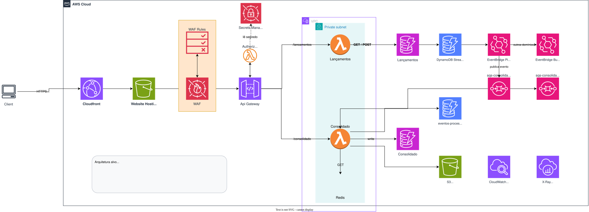

# Sistema de Controle de Fluxo de Caixa

Solução serverless na AWS para um comerciante registrar lançamentos (débitos e
créditos) e consultar o saldo diário consolidado.

---

## Índice da documentação

O README é a porta de entrada. O detalhamento arquitetural está em `docs/`.

| Documento | Conteúdo |
|---|---|
| [Domínios e capacidades de negócio](docs/01-dominios-e-capacidades.md) | Mapa de capacidades, bounded contexts, context map, linguagem ubíqua |
| [Requisitos e NFRs](docs/02-requisitos-e-nfrs.md) | Requisitos refinados, SLIs/SLOs, premissas assumidas |
| [Arquitetura alvo — C4](docs/03-arquitetura-alvo.md) | Diagramas de contexto, contêiner e componente; fluxos; modelo de dados |
| [Arquitetura de transição](docs/04-arquitetura-transicao.md) | Migração de legado em 6 fases (Strangler Fig), riscos e cronograma |
| [Estimativa de custos](docs/05-estimativa-custos.md) | Dois cenários, otimizações, ponto de virada serverless × containers |
| [Observabilidade](docs/06-observabilidade.md) | SLIs, catálogo de alarmes justificados, métricas de negócio, runbooks |
| [Segurança](docs/07-seguranca.md) | Modelo de ameaças, autenticação/autorização, critérios de integração |
| [ADR-001 — Serverless e granularidade](docs/adr/0001-serverless-e-granularidade-dos-servicos.md) | Por que dois serviços; por que Lambda e não containers |
| [ADR-002 — DynamoDB vs. relacional](docs/adr/0002-dynamodb-vs-relacional.md) | Escolha do banco e crítica à modelagem atual |
| [ADR-003 — Comunicação assíncrona](docs/adr/0003-comunicacao-assincrona.md) | SQS vs. SNS vs. Kinesis; idempotência; outbox |
| [ADR-004 — Agregação incremental](docs/adr/0004-agregacao-incremental-vs-recalculo.md) | Por que o desenho atual não atende 50 rps e como corrigir |
| [ADR-005 — Consistência eventual](docs/adr/0005-consistencia-eventual.md) | O trade-off imposto pelo requisito de isolamento |
| [Estratégia de testes](tests/README.md) | Camadas, cobertura, lacunas conhecidas, teste de carga |
| [Documentação da API](api_documentation.md) | Endpoints, payloads, códigos de retorno |

---

## Como rodar localmente

Sem conta AWS, sem credencial, sem Docker. Só Python 3.10+.

```bash
python tarefas.py instalar
```

```bash
python tarefas.py subir
```

```bash
python tarefas.py rodar
```

> Em Linux e macOS, `make install`, `make up` e `make run` fazem o mesmo.
> `tarefas.py` existe porque o `make` não vem instalado no Windows, e exigir que
> o avaliador instale um utilitário só para rodar o projeto seria atrito
> desnecessário. Os dois caminhos são equivalentes.

A API sobe em `http://localhost:3000`. Em outro terminal:

```bash
curl -X POST http://localhost:3000/lancamentos -H 'Content-Type: application/json' -d '{"tipo":"CREDITO","valor":"1500.50","descricao":"Venda balcao"}'
```

```bash
curl "http://localhost:3000/consolidado?data=$(date +%F)"
```

O saldo aparece alguns segundos depois do lançamento — essa defasagem é a
consistência eventual em ação, e é intencional ([ADR-005](docs/adr/0005-consistencia-eventual.md)).

Para encerrar:

```bash
python tarefas.py derrubar
```

### O que roda no ambiente local

| Componente na AWS | Substituto local |
|---|---|
| API Gateway | Roteador HTTP em `scripts/api_local.py`, que traduz a requisição no mesmo evento proxy (`httpMethod`, `resource`, `pathParameters`) |
| Lambda | Um processo Python por serviço, invocando o mesmo `lambda_handler` sem alteração |
| Lambda Authorizer | **Ausente localmente.** O roteador não valida token, para não exigir credencial AWS no desenvolvimento. A API implantada exige |
| Event Source Mapping | Thread que faz long polling na fila e entrega o evento no formato `{"Records": [...]}` |
| DynamoDB, SQS, S3, EventBridge | Emulados em memória (`moto`) |
| ElastiCache Redis | Ausente. O código já trata cache indisponível caindo para o banco |

Alternativa com emuladores reais em contêiner (DynamoDB Local + ElasticMQ):

```bash
make up-docker
```

### Demais comandos

```bash
python tarefas.py
```

| Comando | Equivalente com make | O que faz |
|---|---|---|
| `python tarefas.py testar` | `make test` | Roda as três suítes (128 testes) |
| `python tarefas.py cobertura` | `make cov` | Roda com relatório de cobertura |
| `python tarefas.py lacunas` | `make lacunas` | Lista as lacunas conhecidas do MVP |
| `python tarefas.py carga` | `make carga API_URL=...` | Teste de carga de 50 rps (requer k6) |
| `python tarefas.py empacotar` | `make package` | Empacota as Lambdas a partir do fonte |

---

## Arquitetura

### Domínios

O sistema tem **dois bounded contexts**, separados por terem requisitos de
disponibilidade **opostos** — e não por conveniência técnica:

| | **Lançamentos** | **Consolidação** |
|---|---|---|
| Responsabilidade | Registrar o fato financeiro | Apurar a posição diária |
| Natureza do dado | Fonte da verdade, imutável | Derivado, reconstruível |
| Consistência | Forte | Eventual (p95 < 30 s) |
| Disponibilidade alvo | 99,9% | 99,5% |
| Se cair | Venda perdida, irrecuperável | Nada se perde; recalcula |

Essa diferença é o que justifica o requisito não-funcional do enunciado — *"o
serviço de lançamento não deve ficar indisponível se o consolidado cair"* — e é
de onde decorre toda a arquitetura. Detalhamento em
[domínios e capacidades](docs/01-dominios-e-capacidades.md).

### Fluxo



> A imagem é um **SVG editável**: o XML do draw.io está embutido nela, então o
> mesmo arquivo renderiza aqui e abre no [diagrams.net](https://app.diagrams.net)
> para edição. Sem duas cópias para manter em sincronia.

O acoplamento entre os dois é **apenas a fila**. Consolidação nunca chama
Lançamentos.

### Justificativa das escolhas

Cada decisão está registrada como ADR, com **alternativas consideradas e
descartadas** — não apenas com a lista de vantagens da opção escolhida:

| Decisão | Alternativa principal descartada | Por quê |
|---|---|---|
| Dois serviços serverless | Monólito em Fargate | Não atenderia o isolamento de falhas exigido |
| DynamoDB | Aurora Serverless v2 | Custo de piso 24×7 e atrito de pool de conexões com Lambda |
| SQS Standard | SQS FIFO / Kinesis | Ordem é desnecessária (soma é comutativa); FIFO limitaria a 300 msg/s por grupo |
| Consistência eventual | Escrita síncrona nas duas tabelas | Recriaria o acoplamento que o requisito proíbe |

---

## Estado da implementação

Esta seção separa o que **está implantado** do que é **arquitetura alvo**.
Componentes de desenho aparecem nos diagramas mas não estão no MVP.

### Implementado

| Componente | Papel |
|---|---|
| API Gateway (REST) | Entrada única, validação de payload, throttling, WAF |
| Lambda Lançamentos | Registro, validação, publicação de evento |
| Lambda Consolidado | Consumo do evento, apuração, consultas |
| DynamoDB (2 tabelas) | Persistência, com KMS e PITR |
| SQS + DLQ | Desacoplamento entre os domínios |
| ElastiCache Redis | Cache de leitura, Multi-AZ |
| S3 | Arquivamento de relatórios |
| CloudWatch + X-Ray | Métricas, alarmes, dashboard, tracing |
| WAF | Proteção de borda e rate limiting |
| **Lambda Authorizer** | **Autenticação JWT e autorização por escopo em todos os endpoints de negócio** |
| CloudFormation | Infra como código, em stacks aninhadas |

### Arquitetura alvo, ainda não implementada

| Componente | Motivo de estar no alvo |
|---|---|
| CloudFront + S3 estático | Distribuição do frontend com cache de borda |
| DynamoDB Streams → EventBridge Pipes | Outbox transacional ([ADR-003](docs/adr/0003-comunicacao-assincrona.md)) |
| Job de reconciliação | Detectar divergência entre lançamentos e saldo |
| Pipeline de CI/CD | Lint, testes, análise estática de IaC, deploy |

### Limitações conhecidas

Estão documentadas, priorizadas e **cobertas por teste** — não são surpresas:

| # | Limitação | Impacto |
|---|---|---|
| 1 | Apuração recalcula o dia por varredura de tabela | **Não atende os 50 rps do enunciado** ([ADR-004](docs/adr/0004-agregacao-incremental-vs-recalculo.md)) |
| 2 | Consolidado lê a base de Lançamentos | Acoplamento de dados; ameaça o isolamento exigido |
| 3 | Escrita dupla banco+fila sem transação | Evento pode se perder silenciosamente ([ADR-003](docs/adr/0003-comunicacao-assincrona.md)) |
| 4 | Dia de negócio apurado em UTC | Venda após 21h (BRT) cai no dia seguinte do relatório |
| 5 | Dinheiro serializado como `float` na resposta | Erro acumula em somatórios |
| 6 | Sem `comerciante_id` no modelo | Sistema funciona para um único comerciante |
| 7 | Sem CI/CD | Deploy manual |
| 8 | Ambiente local roda sem autenticação | O roteador local não invoca o authorizer; a API implantada exige token |

```bash
python tarefas.py lacunas
```

---

## Evoluções futuras

**Curto prazo (fecha as lacunas críticas)**
- Autenticação: OAuth 2.0 *client credentials* para integração servidor-a-servidor,
  Cognito/OIDC para acesso humano, escopos por endpoint (`lancamentos:write`,
  `consolidado:read`), mTLS para parceiros
- Agregação incremental com contador atômico + deduplicação transacional
- Chave composta com `comerciante_id` (multi-tenant por construção)
- Roles separadas por função; remoção de `ec2:DeleteSecurityGroup` da política
- Alarmes de DLQ e de defasagem do saldo; retenção de log
- Pipeline de CI/CD com `cfn-lint` e `checkov`

**Médio prazo**
- Estorno de lançamento como evento de compensação (prática contábil correta)
- Job diário de reconciliação, publicando a divergência como métrica de negócio
- Camada analítica: arquivamento no S3 + Athena, separando o caminho analítico do
  transacional
- Projeções adicionais a partir do mesmo fluxo de eventos: saldo por categoria,
  por meio de pagamento, projeção de fluxo futuro

**Longo prazo**
- Registro como *event sourcing* pleno, com o saldo virando uma entre várias
  projeções
- Multi-região ativo-passivo, se o RTO exigido justificar o custo
- Antecipação de recebíveis e conciliação bancária como novos bounded contexts,
  consumindo o mesmo barramento de eventos sem alterar o produtor

---

## Implantação na AWS

**Pré-requisitos:** conta AWS ativa, AWS CLI configurado, e uma role de execução
para o CloudFormation com permissão de criar os recursos.

**1.** Empacote as funções e as camadas:

```bash
python tarefas.py empacotar
```

Os `.zip` são gerados em `infra/lambdas/` e **não são versionados** — binário no
repositório impede build reproduzível, porque não há garantia de que o pacote
corresponda ao código. Este passo é obrigatório.

**2.** Crie um bucket e envie templates e pacotes:

```bash
aws s3 sync . s3://<NOME_BUCKET> --exclude ".venv/*" --exclude ".git/*" --exclude "dist/*"
```

**3.** Crie a stack:

```bash
aws cloudformation create-stack --stack-name gft-challenge --template-url https://s3.amazonaws.com/<NOME_BUCKET>/infra/cfn/main.yml --parameters ParameterKey=AlertEmail,ParameterValue=<SEU_EMAIL> ParameterKey=BucketCFN,ParameterValue=<NOME_BUCKET> --capabilities CAPABILITY_NAMED_IAM
```

A stack `main.yml` orquestra stacks aninhadas: rede, security groups, KMS,
DynamoDB, buckets, SQS/SNS, Redis, Secrets, Lambdas, API Gateway e
observabilidade.

**4.** A API implantada exige autenticação. Gere um token para testá-la:

```bash
python scripts/gerar_token.py --projeto gft-challenge --ambiente prod
```

```bash
curl -H "Authorization: Bearer $TOKEN" "https://<api-id>.execute-api.<regiao>.amazonaws.com/prod/consolidado"
```

Para ver a autorização por escopo em ação, gere um token restrito — ele registra
lançamento mas recebe **403** ao tentar ler o saldo:

```bash
python scripts/gerar_token.py --escopos lancamentos:write
```

---

## Estrutura do repositório

```
apps/
  lancamentos/     código do serviço de registro
  consolidado/     código do serviço de apuração
docs/
  adr/             decisões arquiteturais (contexto, alternativas, consequências)
  diagramas/       fonte editável em draw.io (a visão canônica é o Mermaid em 03-)
  01-dominios-e-capacidades.md
  02-requisitos-e-nfrs.md
infra/cfn/         infraestrutura como código (CloudFormation)
scripts/           execução local e empacotamento
tests/
  lancamentos/     suíte do serviço de registro
  consolidado/     suíte do serviço de apuração
  carga/           teste de carga k6 (NFR de 50 rps)
```
