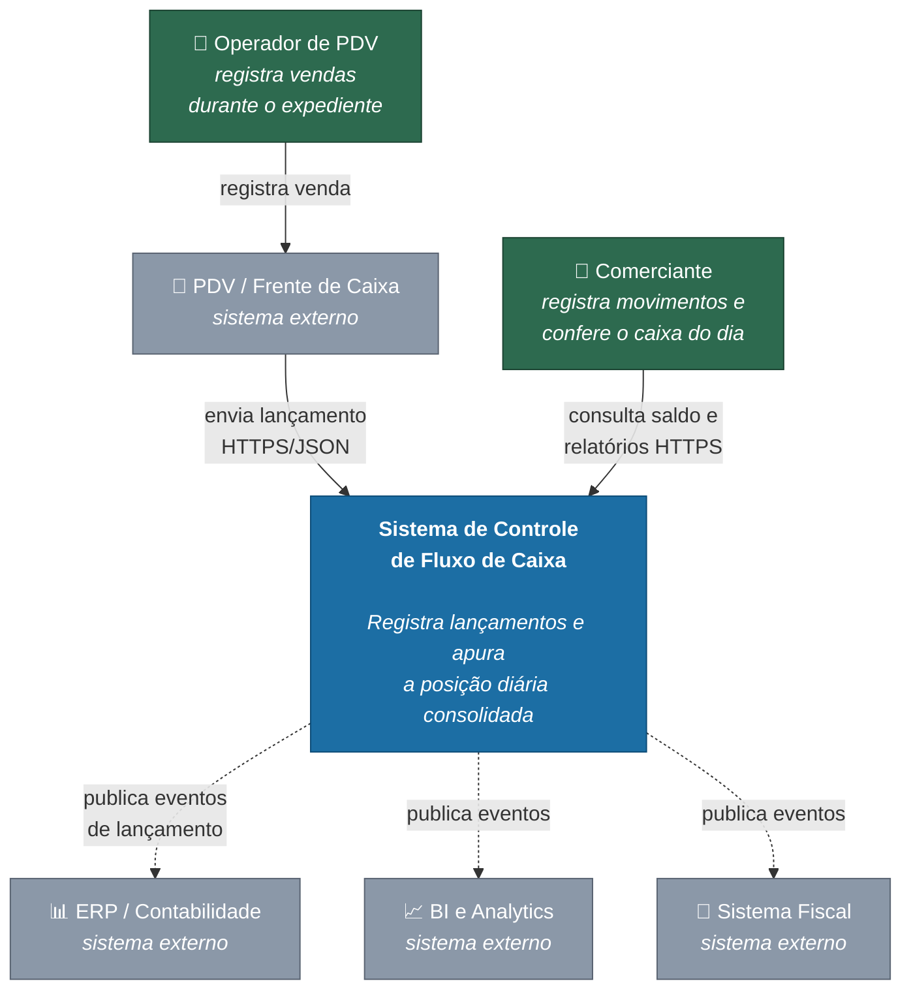
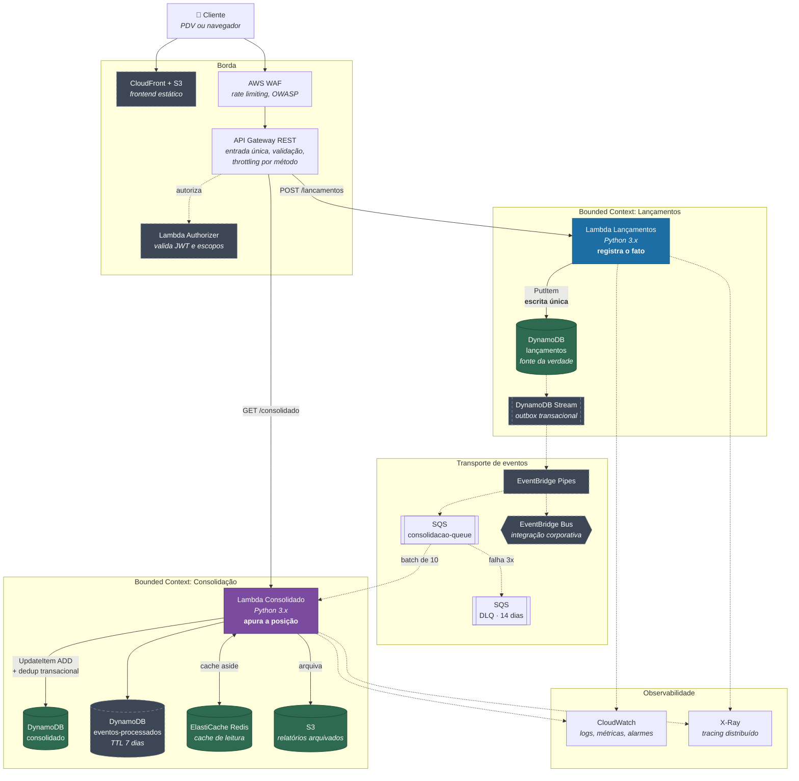
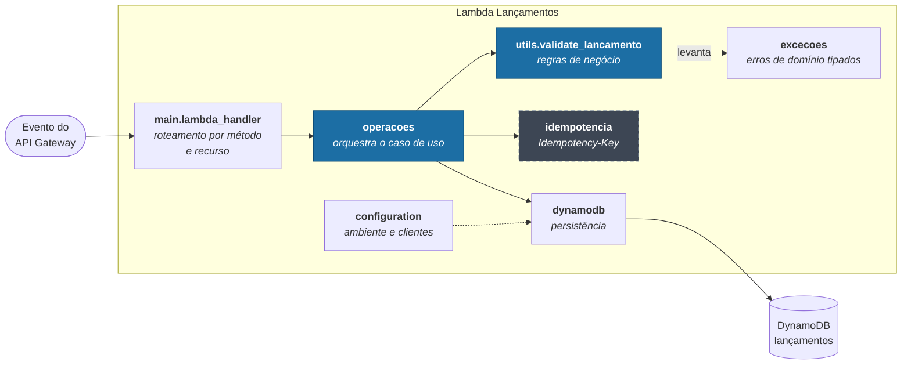
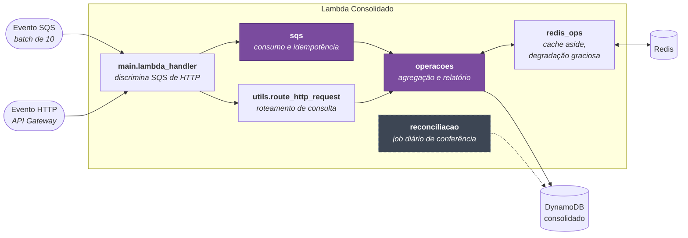
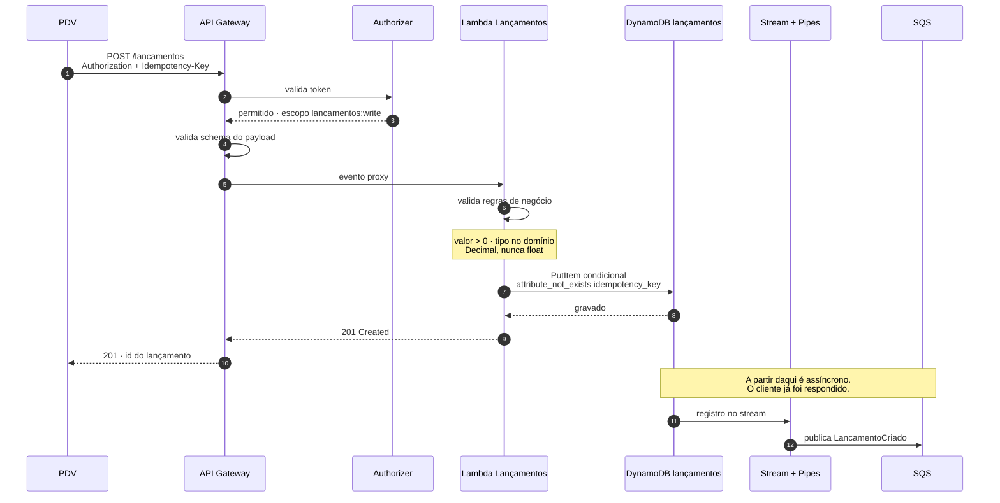
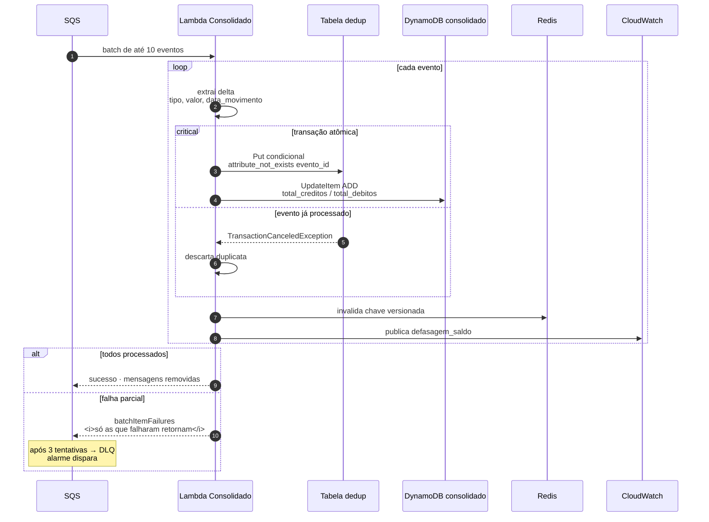
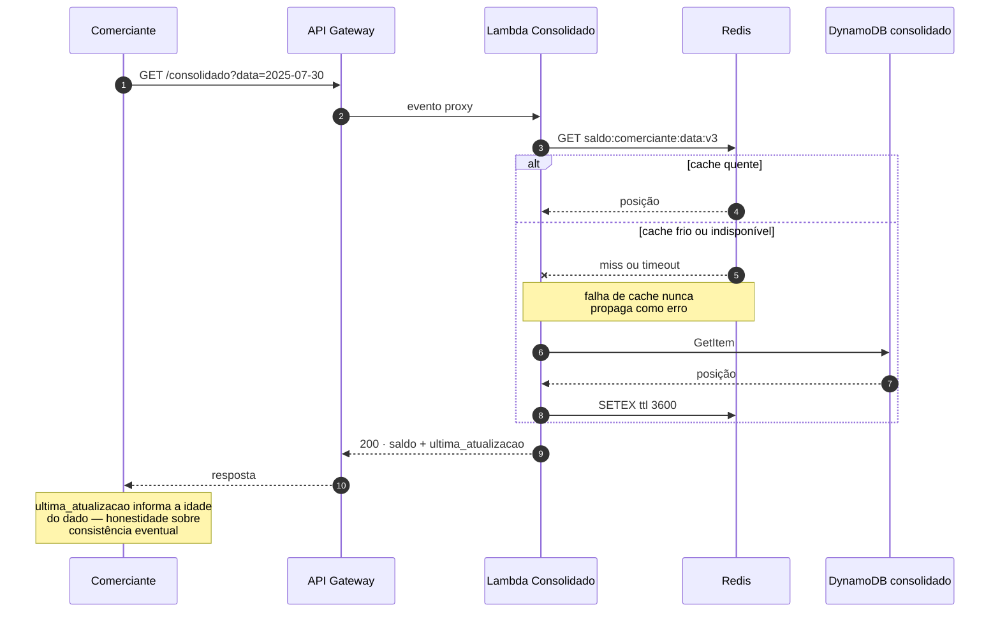
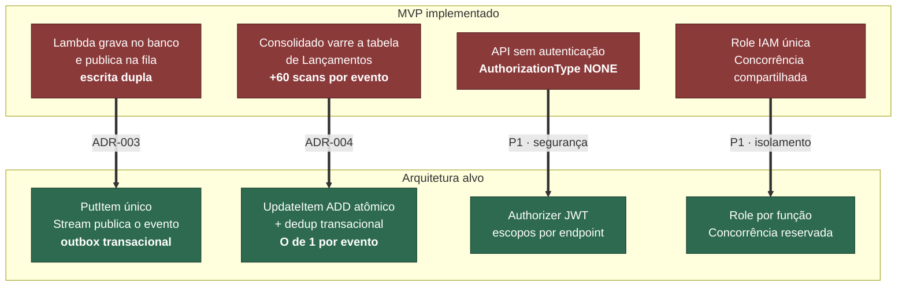

# Arquitetura alvo — visão C4

> Requisito obrigatório do desafio: *"Desenho da solução completo (Arquitetura Alvo)"*.

Os diagramas seguem o modelo [C4](https://c4model.com), do mais abstrato para o
mais concreto. Estão em Mermaid, então renderizam direto no GitHub — sem
depender de ferramenta externa nem de imagem que envelhece separada do texto.

> Existe também uma versão em draw.io com os ícones oficiais da AWS em
> [`diagramas/arquitetura-fluxo-de-caixa.drawio`](diagramas/arquitetura-fluxo-de-caixa.drawio),
> mantida como **fonte editável** para apresentação. Os diagramas Mermaid abaixo
> são a visão canônica: um `.drawio` não renderiza no GitHub, e um diagrama que
> exige download para ser visto acaba não sendo visto.

**Convenção usada em todos os diagramas:**
linha cheia = síncrono · linha tracejada = assíncrono ·
componente pontilhado = arquitetura alvo, ainda não implementado.

---

## Nível 1 — Contexto

Quem usa o sistema e com o que ele conversa. Sem nenhum detalhe de tecnologia:
este é o diagrama que se mostra para um interlocutor de negócio.



**O que este diagrama comunica:** o sistema é **fonte de eventos** para o resto
da organização, não um silo. ERP, BI e fiscal consomem sem que o fluxo de caixa
precise conhecê-los — é o que sustenta o requisito de *"soluções reutilizáveis e
flexíveis"* do enunciado.

---

## Nível 2 — Contêineres

As unidades implantáveis e como se comunicam.



### O que sustenta o requisito de isolamento

O único caminho entre os dois contextos é **a fila**, e a seta é de mão única.
Isso resolve o acoplamento *temporal* — mas não basta. Quatro recursos ainda
precisam ser segregados:

| Recurso | Controle necessário |
|---|---|
| Concorrência Lambda | `ReservedConcurrentExecutions` no produtor (piso garantido) + `ScalingConfig.MaximumConcurrency` no consumidor (teto imposto) |
| Cota do API Gateway | `MethodSettings` por `ResourcePath`, não um limite único no stage |
| Base de dados | Cada contexto dono exclusiva da sua tabela |
| Permissão IAM | Uma role por função |

> ⚠️ **Estado atual:** os quatro estão compartilhados. Detalhe em
> [requisitos e NFRs §2.1](02-requisitos-e-nfrs.md#21-os-dois-requisitos-explícitos-do-enunciado).

---

## Nível 3 — Componentes

### Lambda Lançamentos



**`utils.validate_lancamento` é o coração do domínio** — é onde vivem as
invariantes (valor positivo, tipo no domínio, descrição no limite). Por ser
função pura, sem dependência de infraestrutura, é testável sem mock: 27 dos 94
testes atacam exclusivamente ela.

### Lambda Consolidado



**Uma função, dois gatilhos.** O mesmo deployable atende a fila e o HTTP,
discriminando pelo formato do evento. É uma decisão de simplicidade consciente —
e tem um custo que vale nomear: um pico de consultas e um pico de consolidação
disputam a mesma cota de concorrência. Se a leitura e a escrita passarem a ter
perfis de carga muito diferentes, separar em duas funções é o próximo passo.

---

## Fluxos

### Registro de lançamento — caminho feliz



**O ponto de virada é o passo 8.** A resposta ao cliente sai assim que o fato
está durável, e a propagação acontece depois. Se o cliente tivesse que esperar a
consolidação, a disponibilidade do registro passaria a ser o **produto** das duas
— violando o requisito do enunciado.

**O `PutItem` é a única escrita.** A publicação do evento é consequência
garantida dela, via stream. É o que elimina a escrita dupla descrita no
[ADR-003](adr/0003-comunicacao-assincrona.md).

### Consolidação assíncrona



**Os dois detalhes que fazem esse fluxo funcionar:**

**A transação (passos 3–4).** `ADD` é atômico mas **não idempotente** — uma
reentrega somaria o valor duas vezes. Amarrar o contador ao marcador de
deduplicação numa transação dá efeito de *exatamente-uma-vez* sobre um transporte
que entrega *ao-menos-uma-vez*.

**O `batchItemFailures`.** Sem ele, uma falha na décima mensagem devolve as dez à
fila e as nove já aplicadas são somadas de novo. Com agregação incremental, isso
é **valor contabilizado em dobro**.

### Consulta de saldo com cache



**O cache nunca é caminho crítico.** Redis fora do ar degrada latência, não
disponibilidade — comportamento já implementado em `redis_ops.get_redis_client`.

**`ultima_atualizacao` na resposta** é o que torna a consistência eventual
honesta: o cliente recebe o número **e** quando ele foi apurado, e decide se
confia.

---

## Delta entre o alvo e o implementado



Cada seta corresponde a um teste `xfail(strict=True)` já escrito: quando a
correção entrar, o teste passa e o pytest exige a atualização do status.

```bash
python tarefas.py lacunas
```

---

## Modelo de dados alvo

Tabela única por contexto, com chave composta. Ver
[ADR-002](adr/0002-dynamodb-vs-relacional.md) para a justificativa e a crítica ao
modelo atual.

| Tabela | PK | SK | Atributos |
|---|---|---|---|
| `lancamentos` | `COMERCIANTE#<id>` | `LANC#<data_movimento>#<uuid>` | tipo, valor (Decimal), descricao, categoria, tags, status, data_hora_evento, idempotency_key |
| `consolidado` | `COMERCIANTE#<id>` | `DIA#<YYYY-MM-DD>` | total_creditos, total_debitos, quantidade_lancamentos, saldo_final, ultima_atualizacao |
| `eventos-processados` | `EVENTO#<evento_id>` | — | processado_em, ttl |

**Consultas que essa chave habilita, sem nenhum índice secundário:**

| Necessidade | Operação |
|---|---|
| Lançamentos do comerciante em um período | `Query` com `begins_with` / `between` na SK |
| Saldo de um dia | `GetItem` |
| Saldos de um mês | `Query` com `between` na SK |
| Verificar duplicata | `GetItem` na tabela de dedup |

Nenhum `scan`. Nenhum GSI. O isolamento entre comerciantes é garantido **pela
chave**, não por filtro de aplicação — o que também elimina a classe de bug em
que um `if` esquecido vaza dados entre clientes.
