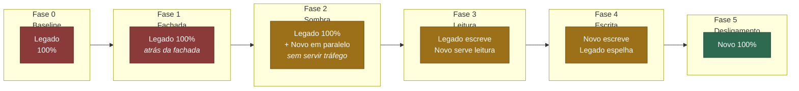
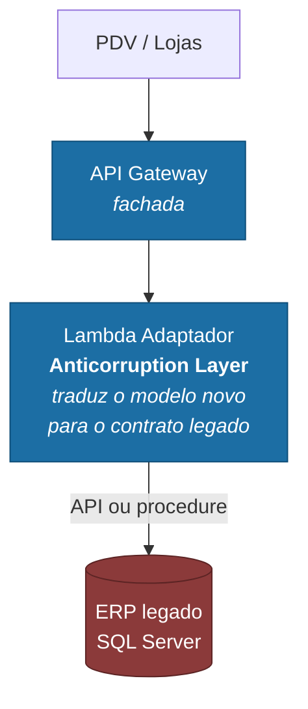
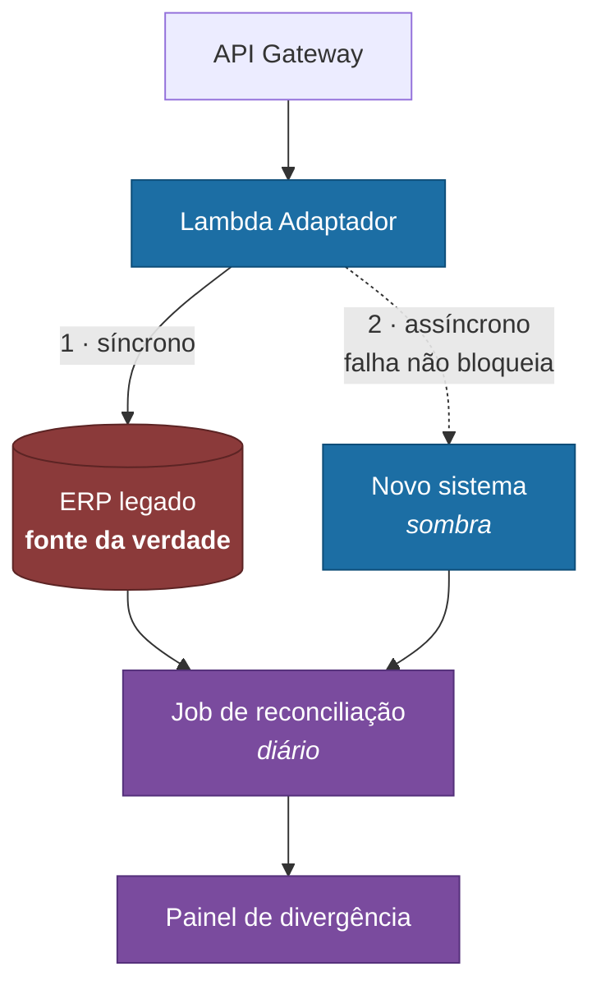
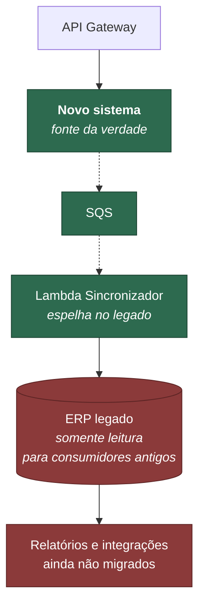
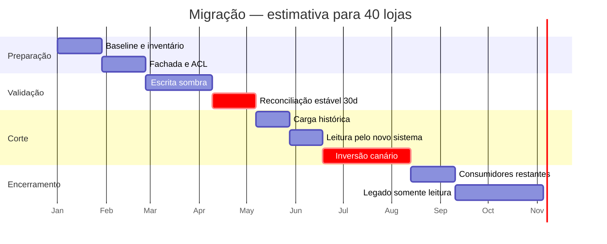

# Arquitetura de transição — migração do legado

> Requisito **diferencial** do desafio: *"Desenho da solução da Arquitetura de
> Transição (se necessária, considerando uma migração de legado)"*.

O enunciado não descreve um legado. Como a competência avaliada é a **capacidade
de conduzir uma migração**, este documento modela um cenário realista e explícito,
e desenha a transição sobre ele.

**Premissa central deste documento:** ninguém desliga o sistema que controla o
dinheiro num sábado à noite e liga o novo na segunda. Migração de sistema
financeiro é feita em **coexistência**, com reconciliação contínua e caminho de
volta em cada etapa.

---

## 1. O legado modelado

Um cenário comum no varejo brasileiro de médio porte:

| Aspecto | Situação |
|---|---|
| Sistema | ERP monolítico, cliente-servidor, ~12 anos de operação |
| Tecnologia | Delphi/VB no cliente, SQL Server no servidor, procedures com regra de negócio |
| Fluxo de caixa | Módulo interno, tabela `MOVIMENTO_CAIXA` |
| Lançamentos | Digitados manualmente ou importados de arquivo do PDV, em lote noturno |
| Consolidação | Procedure `SP_FECHAMENTO_DIARIO`, agendada às 23h |
| Relatórios | Crystal Reports, direto contra a base de produção |
| Integrações | Arquivos CSV em pasta compartilhada, lidos por *scheduled task* |
| Base instalada | 40 lojas, ~15 mil lançamentos/dia |

### Dores que justificam a migração

| Dor | Consequência de negócio |
|---|---|
| Saldo só existe após o fechamento das 23h | O gerente não sabe a posição do dia durante o expediente |
| Relatório roda na base transacional | Relatório pesado trava o caixa em horário de pico |
| Regra de negócio dentro de procedure | Nenhum teste automatizado; qualquer mudança é risco |
| Integração por arquivo em pasta | Falha silenciosa; ninguém sabe que o arquivo não chegou |
| Escala vertical | Pico de fim de mês exige servidor dimensionado para o pico o ano inteiro |

**A dor nº 1 é a que financia o projeto.** As outras são consequências técnicas;
essa é perda de capacidade de decisão do negócio, e é com ela que se justifica o
orçamento.

---

## 2. Estratégia: Strangler Fig

O padrão *Strangler Fig* (Martin Fowler) substitui o legado **por capacidade**,
não por big bang: uma fachada intercepta as chamadas e vai redirecionando
funcionalidades ao novo sistema, uma de cada vez, até o legado ficar sem
responsabilidade e poder ser desligado.

**Por que não big bang:** a data de corte concentra todo o risco num único
instante, sem rollback viável — os dados novos já nasceram no sistema novo. Para
dados financeiros, com obrigação fiscal e conciliação bancária, é risco
inaceitável.

**Por que não reescrita paralela ("big rewrite"):** o legado continua evoluindo
durante a reescrita, e o alvo persegue um alvo móvel. Historicamente é o modo de
falha mais comum em substituição de sistema legado.

Cada fase tem **critério de entrada, critério de saída e rollback**. Nenhuma
avança por calendário — só por evidência.

---

## 3. As fases

### Fase 0 — Linha de base e instrumentação
**Duração estimada:** 2–4 semanas · **Risco:** baixo

Não se migra o que não se mede. Antes de qualquer código:

- Instrumentar o legado para conhecer volume real por hora, por loja, distribuição
  de valores, taxa de estorno
- Levantar **todos** os consumidores da tabela `MOVIMENTO_CAIXA` — relatórios,
  planilhas, integrações, aquele Access que alguém do financeiro usa há 8 anos
- Congelar o contrato: documentar o schema e as regras implícitas nas procedures
- Definir as métricas de sucesso da migração

> **O levantamento de consumidores é a atividade que mais evita surpresa.** Em
> sistema legado, sempre existe um consumidor não documentado lendo a base
> direto. Descobri-lo na Fase 5 é incidente; na Fase 0 é planejamento.

**Critério de saída:** inventário completo de consumidores e baseline de volume
publicados.

### Fase 1 — Fachada (Strangler Facade)
**Duração:** 3–4 semanas · **Risco:** médio — é o ponto de interceptação

Introduz o API Gateway na frente, **sem mudar comportamento**. Todo o tráfego
continua indo para o legado, agora através de um adaptador.

**O Anticorruption Layer é o artefato mais importante desta fase.** Ele traduz
entre o modelo do novo domínio (`Lancamento` com `tipo`, `valor` como Decimal,
`data_movimento`) e o contrato do legado (`MOVIMENTO_CAIXA` com `FLAG_DC CHAR(1)`,
`VLR_MOV FLOAT`, `DT_MOV DATETIME`). Sem ele, as peculiaridades do legado vazam
para o modelo novo e a migração termina reproduzindo o problema que veio resolver.

**Rollback:** apontar o DNS de volta para o endpoint antigo. Minutos.

**Critério de saída:** 100% do tráfego pela fachada por 2 semanas, sem regressão
de latência ou erro.

### Fase 2 — Escrita sombra e reconciliação
**Duração:** 4–6 semanas · **Risco:** baixo — nada depende do novo sistema ainda

O adaptador passa a gravar **nos dois**: o legado continua sendo a verdade, e o
novo sistema recebe uma cópia. O novo **não serve nenhum tráfego**.

**A escrita no novo sistema é assíncrona e não bloqueante.** Se ela falhar, o
lançamento no legado acontece do mesmo jeito. Nesta fase o novo sistema não pode,
sob nenhuma hipótese, causar incidente em produção.

**A reconciliação é o produto desta fase.** Todo dia, para cada loja:

| Comparação | Tolerância |
|---|---|
| Quantidade de lançamentos | zero divergência |
| Soma de créditos | zero divergência |
| Soma de débitos | zero divergência |
| Saldo final do dia | zero divergência |

Toda divergência vira item de investigação. **É aqui que se descobrem as regras
não documentadas** — o arredondamento diferente, o estorno que o legado trata
como valor negativo em vez de tipo, o lançamento de ajuste que só a contabilidade
conhece.

**Critério de saída — e este é o portão mais rígido de todo o projeto:**
**30 dias consecutivos com zero divergência**, incluindo um fechamento de mês.

> Fechamento de mês precisa estar dentro da janela porque é quando aparecem os
> lançamentos de ajuste, provisão e rateio — que não ocorrem no dia a dia e são
> justamente os que quebram premissas.

### Fase 3 — Carga histórica e leitura pelo novo sistema
**Duração:** 3–4 semanas · **Risco:** médio

**Carga histórica.** Migrar 5 anos de `MOVIMENTO_CAIXA` (prazo fiscal brasileiro):

- Extração incremental por período, em lotes — nunca de uma vez
- AWS DMS ou exportação para S3 + processamento em lote
- O consolidado histórico é **recalculado** a partir dos lançamentos, não copiado:
  se o legado tiver saldo errado, a migração não deve perpetuá-lo
- Conferência: soma por mês do legado × soma por mês do novo, mês a mês

**Corte de leitura.** Os relatórios passam a ser servidos pelo novo sistema,
progressivamente:

1. Relatórios internos, de baixa criticidade
2. Relatórios operacionais das lojas
3. Relatórios contábeis e fiscais — por último, porque são os de maior consequência

**Rollback:** apontar o relatório de volta ao legado. A escrita ainda é do legado,
então não há perda de dado.

**Critério de saída:** todos os relatórios servidos pelo novo sistema por 2
semanas, com conferência amostral pela contabilidade.

### Fase 4 — Inversão da escrita
**Duração:** 6–8 semanas · **Risco:** alto — é o ponto de não retorno gradual

Inverte-se o sentido: **o novo sistema passa a ser a fonte da verdade** e o legado
recebe o espelho, para que os consumidores ainda não migrados continuem
funcionando.

**A inversão é por canário, nunca global.** A ordem é deliberada:

| Onda | Escopo | Por quê |
|---|---|---|
| 1 | 1 loja piloto, a de menor volume | Impacto contido; erro afeta pouca gente |
| 2 | 5 lojas de perfis diferentes | Expõe variação regional e de comportamento |
| 3 | 25% da base | Primeiro teste de carga real |
| 4 | 100% | Só após duas semanas estáveis na onda 3 |

**A reconciliação da Fase 2 continua rodando**, agora no sentido inverso — é a
rede de segurança que permite detectar problema antes que ele vire prejuízo.

**Rollback:** reverter a loja ao legado. Só é viável **porque o espelhamento
mantém o legado atualizado** — é exatamente por isso que o sincronizador existe.
Sem ele, não haveria caminho de volta.

**Critério de saída:** 100% da escrita no novo sistema, 30 dias estáveis,
reconciliação zerada.

### Fase 5 — Desligamento
**Duração:** 4–8 semanas · **Risco:** baixo, se as fases anteriores foram cumpridas

1. Migrar os consumidores restantes (aqueles do inventário da Fase 0)
2. Desligar o sincronizador
3. Colocar o legado em **somente leitura** — e mantê-lo assim por 2 ciclos
   contábeis fechados
4. Arquivar a base do legado em armazenamento frio, respeitando o prazo fiscal
5. Desprovisionar

> **Manter o legado em somente leitura por dois fechamentos contábeis** é
> barato e resolve a auditoria que aparece três meses depois perguntando de um
> lançamento de abril.

---

## 4. Estratégia de dados

### Coexistência

| Aspecto | Decisão |
|---|---|
| Fonte da verdade | Explícita e única em cada fase — nunca ambígua |
| Sentido da sincronização | Muda na Fase 4; nunca bidirecional simultânea |
| Identificador | O novo sistema guarda `id_legado`, permitindo rastrear a origem |
| Conflito | Impossível por construção: só um lado escreve por vez |

**Sincronização bidirecional simultânea é a decisão que mais afunda migração de
dados.** Ela cria conflito de escrita sem resolução determinística. O desenho
acima evita isso mantendo um único escritor em cada fase.

### Captura de mudança

Para espelhar o legado sem alterá-lo:

| Opção | Quando usar | Trade-off |
|---|---|---|
| Trigger no SQL Server → tabela de outbox | Legado pode ser alterado minimamente | Simples; adiciona carga à transação |
| AWS DMS com CDC | Legado não pode ser tocado | Sem invasão; depende do log de transação |
| Debezium | Já existe Kafka na casa | Poderoso; mais uma peça a operar |
| Polling por `updated_at` | Último recurso | Perde deleções; janela de perda |

Para este cenário eu escolheria **DMS com CDC**: não exige alteração no legado
(que é onde mora o risco político e técnico) e a Fase 2 é justamente o período
para validar sua confiabilidade.

---

## 5. Riscos e mitigação

| Risco | Prob. | Impacto | Mitigação |
|---|---|---|---|
| Regra de negócio não documentada em procedure | **Alta** | Alto | A reconciliação da Fase 2 existe para isso; 30 dias com fechamento de mês incluído |
| Consumidor desconhecido lendo a base | **Alta** | Médio | Inventário na Fase 0; legado em leitura por 2 ciclos na Fase 5 |
| Divergência de arredondamento | Média | Alto | Decimal ponta a ponta; conferência ao centavo |
| Carga histórica com dado sujo | Média | Médio | Recalcular consolidado em vez de copiar; quarentena para inconsistentes |
| Fuso e virada de dia divergentes | Média | Alto | `data_movimento` explícita; conferir a janela do fechamento das 23h |
| Resistência das lojas | Média | Médio | Canário por loja; piloto com quem tem apetite |
| Projeto perde patrocínio no meio | Média | **Alto** | Cada fase entrega valor isolado — a Fase 3 já dá saldo em tempo real |

**O último risco é o mais subestimado.** Migração de 8–12 meses atravessa
mudança de orçamento e de prioridade. Por isso as fases são desenhadas para
entregar valor **antes** do fim: na Fase 3 o gerente já tem a posição do dia
durante o expediente, que é a dor que financiou o projeto. Se a migração parar
ali, o investimento já se pagou.

---

## 6. Cronograma

**Total: 10 a 12 meses.** Dois marcos são inegociáveis e estão marcados como
críticos: os 30 dias de reconciliação zerada e a inversão por canário. Comprimir
qualquer um dos dois é trocar prazo por risco financeiro.

---

## 7. Métricas de sucesso

| Categoria | Métrica | Meta |
|---|---|---|
| Corretude | Divergência na reconciliação | **Zero**, ao centavo |
| Negócio | Latência do saldo | De 23h (batch) para < 30 s |
| Negócio | Disponibilidade do registro | 99,9% |
| Operação | Incidentes causados pela migração | Zero de severidade 1 |
| Operação | Rollbacks executados | Aceitável; **rollback usado é sinal de que o processo funciona** |
| Custo | Custo total de propriedade | Redução vs. licença + servidor + DBA |

A penúltima linha merece destaque numa conversa com a liderança: **rollback não é
fracasso**. Um plano de migração em que ninguém nunca voltou atrás é um plano em
que ninguém testou o caminho de volta.
