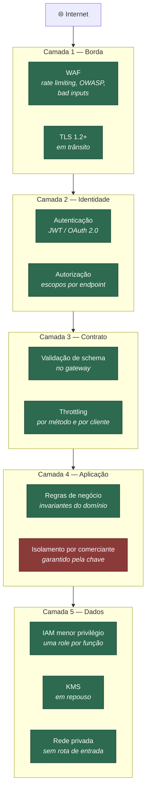

# Segurança e critérios para integração de serviços

> Requisito **diferencial** do desafio: *"Critérios de segurança para consumo
> (integração) de serviços"*. O enunciado também lista segurança entre os
> requisitos gerais: *"autenticação, autorização, criptografia e mecanismos de
> proteção contra ataques"*.

---

## 1. Estado atual

A lacuna mais grave do projeto — **todos os 11 métodos com `AuthorizationType:
NONE`** — foi fechada. A API agora exige token JWT com escopo adequado em todos
os endpoints de negócio, validado por um Lambda Authorizer.

Também foram corrigidos: roles IAM separadas por função, remoção das permissões
`ec2:CreateSecurityGroup` e `ec2:DeleteSecurityGroup` em `Resource: '*'`, rotação
automática da chave KMS, e o rate limiting do WAF passou a agregar por identidade
em vez de por IP (ver §6).

O que **permanece em aberto**: isolamento multi-tenant (não existe
`comerciante_id` no modelo), CORS irrestrito, e o registro do evento inteiro no
log — que agora, com token no cabeçalho, passou a ser um risco concreto de
vazamento de credencial. Detalhes em §7.

## 2. Modelo de ameaças

Ameaças ordenadas por impacto no negócio, não por sofisticação técnica.

| # | Ameaça | Vetor | Impacto | Estado |
|---|---|---|---|---|
| T1 | **Lançamento forjado por terceiro** | API sem autenticação | Fraude direta: saldo do comerciante corrompido | ✅ Mitigado |
| T2 | **Leitura do saldo por terceiro** | API sem autenticação | Vazamento de informação financeira sensível | ✅ Mitigado |
| T3 | **Vazamento entre comerciantes** | Ausência de `comerciante_id` no modelo | Um cliente vê dados de outro | ❌ **Exposto** |
| T4 | **Token vazado em log** | Handler registra o evento inteiro | Escalada de privilégio | ❌ **Exposto — agora crítico** |
| T5 | **Repúdio de lançamento** | Sem identidade associada ao registro | "Não fui eu que lancei" sem como provar | ⚠️ Parcial: identidade autenticada chega à aplicação, mas não é gravada no lançamento |
| T6 | **Escalada via credencial da Lambda** | Role com `ec2:DeleteSecurityGroup` em `*` | Comprometeu a função, derruba a rede | ✅ Mitigado |
| T7 | **Negação de serviço** | Flood na API | Indisponibilidade | ✅ WAF + throttling |
| T8 | **Injeção (SQLi, XSS)** | Payload malicioso | Comprometimento | ✅ WAF + NoSQL + validação |
| T9 | **Interceptação em trânsito** | Man-in-the-middle | Vazamento | ✅ TLS 1.2+ |
| T10 | **Acesso direto ao armazenamento** | Credencial AWS comprometida | Vazamento em massa | ✅ KMS + IAM + bloqueio público |

**T1 a T5 derivavam todas da mesma causa raiz: não existia identidade no
sistema.** A autenticação resolveu T1, T2 e (parcialmente) T5 de uma vez — foi o
item de maior retorno de todo o roadmap.

Atenção a uma consequência: **T4 subiu de prioridade.** Antes não havia token
para vazar; agora há, e o handler continua registrando o evento inteiro no log,
incluindo o cabeçalho `Authorization`. A correção passou a ser urgente.

---

## 3. Defesa em profundidade



Verde = implementado · vermelho = ausente ou incompleto.

---

## 4. Autenticação e autorização — implementado

### Dois públicos, dois mecanismos

| Público | Mecanismo | Por quê |
|---|---|---|
| **Sistemas** (PDV, ERP, parceiros) | **OAuth 2.0 client credentials** — JWT com escopos | Não há usuário humano na chamada; a identidade é da aplicação |
| **Pessoas** (comerciante no portal) | **Cognito / OIDC** com PKCE | Fluxo com consentimento, MFA e recuperação de conta |

### Autorização por escopo, não por papel

O escopo descreve **capacidade**, e mapeia diretamente para o mapa de capacidades
de negócio ([domínios §2](01-dominios-e-capacidades.md#2-mapa-de-capacidades-de-negócio)):

| Escopo | Concede | Quem recebe |
|---|---|---|
| `lancamentos:write` | Registrar lançamento | PDV, frente de caixa |
| `lancamentos:read` | Consultar lançamentos | Portal, ERP |
| `consolidado:read` | Consultar saldo e relatórios | Portal, BI, contabilidade |
| `metricas:read` | Consultar métricas agregadas | BI |

**O PDV recebe apenas `lancamentos:write`.** Ele precisa registrar vendas; não
precisa ler o saldo consolidado do comerciante. Um PDV comprometido numa loja não
expõe a posição financeira do negócio inteiro — **essa é a razão de existir da
autorização por escopo**, e é o que a torna superior a um esquema de "chave de
API que dá acesso a tudo".

### Implementação

```yaml
LancamentosMethod:
  Type: AWS::ApiGateway::Method
  Properties:
    AuthorizationType: CUSTOM       # antes: NONE
    AuthorizerId: !Ref ApiAuthorizer
```

O authorizer é do tipo **REQUEST**, e não TOKEN, porque a decisão depende do
recurso alvo — não apenas do token. `AuthorizationScopes` do CloudFormation só
funciona com authorizers Cognito/JWT nativos; com authorizer customizado, a
verificação de escopo acontece dentro da função, contra o mapa
`ESCOPOS_POR_RECURSO`.

Duas propriedades importantes da implementação em `apps/authorizer/main.py`:

- **Negação por padrão.** Recurso não mapeado, algoritmo inesperado, erro interno
  — tudo resulta em `Deny`. Um endpoint novo que alguém esqueça de mapear fica
  inacessível, em vez de ficar aberto.
- **A resposta de negação não revela o motivo.** Detalhar por que o token falhou
  entrega ao atacante um oráculo para ajustar a próxima tentativa. O motivo vai
  para o log, nunca para o cliente.

`AuthorizerResultTtlInSeconds: 300` cacheia o resultado por identidade: sem isso,
a função rodaria em toda requisição e viraria latência e custo fixos no caminho
crítico.

Cobertura: 33 testes em `tests/authorizer/`, incluindo os ataques clássicos —
`alg: none`, corpo adulterado, token expirado, emissor e audiência trocados,
escopo insuficiente.

### O que uma API Key **não** é

API Key **identifica**, não **autentica** — ela viaja no cabeçalho, aparece em
log, é copiada em cliente. No API Gateway ela existe para associar a requisição a
um *usage plan* (quota e throttling por cliente), e é para isso que deve ser
usada. **Tratá-la como autenticação é um erro comum e caro.**

> A documentação da API descrevia *"Autenticação: API Key (opcional)"*. Nenhuma
> das três palavras se sustentava: não é autenticação, e não era opcional — era
> inexistente. Corrigido junto com a implementação.

---

## 5. Critérios de segurança para integração de serviços

Esta seção responde diretamente ao requisito diferencial. É o **contrato que
qualquer sistema precisa cumprir para consumir esta API**.

### 5.1 Requisitos obrigatórios do consumidor

| # | Critério | Verificação |
|---|---|---|
| C1 | TLS 1.2 ou superior; certificado válido e verificado | Rejeitado no handshake |
| C2 | Token JWT válido, com escopo suficiente | Lambda Authorizer |
| C3 | Rotação de credencial em até 90 dias | Auditoria periódica |
| C4 | Cabeçalho `Idempotency-Key` em toda operação de escrita | Rejeição de duplicata |
| C5 | Cabeçalho `X-Correlation-Id` propagado | Rastreabilidade ponta a ponta |
| C6 | Retentativa com recuo exponencial e *jitter* | Contratual; monitorado por padrão de tráfego |
| C7 | Respeitar `Retry-After` em resposta 429 | Contratual |
| C8 | Payload aderente ao schema publicado | Request validator no gateway |

**C4 e C6 são os que mais protegem o consumidor de si mesmo.** Sem idempotência,
a própria retentativa de C6 duplica lançamentos — os dois critérios só funcionam
juntos. É por isso que idempotência não é "melhoria futura", e sim requisito de
integração.

### 5.2 Níveis de confiança

Nem todo integrador merece o mesmo tratamento. O critério deve ser explícito, não
caso a caso:

| Nível | Quem | Autenticação | Quota | Escopos |
|---|---|---|---|---|
| **Interno** | Serviços da própria organização | IAM SigV4 ou mTLS | Alta | Conforme necessidade |
| **Parceiro** | PDV homologado, ERP contratado | mTLS + OAuth 2.0 | Média, contratada | Mínimo necessário |
| **Público** | Aplicações de terceiros | OAuth 2.0 + API Key | Baixa | Somente leitura |

**mTLS para parceiros** é o critério que mais eleva a barreira: além do token,
exige posse de um certificado cliente emitido pela organização. Um token vazado
sozinho não basta para chamar a API. O API Gateway suporta isso em domínio
customizado.

### 5.3 Critérios para o que o sistema consome

A integração é uma via de mão dupla. Ao consumir serviços externos:

| Critério | Justificativa |
|---|---|
| Nunca confiar em dado externo sem validação | O contrato do parceiro pode mudar sem aviso |
| Timeout explícito em toda chamada | Sem timeout, uma dependência lenta vira indisponibilidade própria |
| Disjuntor (*circuit breaker*) | Impede que a falha do parceiro se propague |
| Anticorruption Layer | O modelo do parceiro não contamina o domínio |
| Credenciais no Secrets Manager, com rotação | Nunca em variável de ambiente nem em código |
| Alocação de orçamento de erro | A indisponibilidade do parceiro consome SLO próprio — precisa ser contabilizada |

### 5.4 Publicação de eventos

O EventBridge é o ponto de integração assíncrona
([ADR-003](adr/0003-comunicacao-assincrona.md)). Critérios:

- **Evento não carrega dado sensível além do necessário.** Publicar identificador
  e valor, não o cadastro completo do comerciante.
- **Regras de barramento com filtro por origem e detalhe**, nunca `"source": "*"`.
- **Cada consumidor com sua própria fila**, para que um consumidor lento não afete
  os demais.
- **Schema versionado** — evento é contrato público; mudança incompatível exige
  nova versão, não alteração no lugar.

---

## 6. Conflito encontrado: o WAF pode bloquear o tráfego que o NFR exige

Este é um achado que só aparece quando se lê a configuração com o requisito na
mão.

A regra de rate limiting em `infra/cfn/apigateway.yml`:

```yaml
- Name: RateLimitRule
  Statement:
    RateBasedStatement:
      Limit: 1000
      AggregateKeyType: IP
```

No WAFv2, `Limit` é **requisições por janela de 5 minutos** (padrão), não por
segundo. Isso significa **~3,3 req/s por IP**.

Agora confronte com o requisito do enunciado:

> *"Em dias de picos, o serviço de consolidado diário recebe 50 requisições por
> segundo."*

**50 req/s vindas de um mesmo IP são 15.000 requisições em 5 minutos — quinze
vezes o limite.** O WAF bloquearia exatamente a carga que o requisito
não-funcional determina que o sistema precisa suportar.

E esse cenário é o mais provável, não o excepcional: uma rede de lojas sai por um
NAT corporativo, e todo o tráfego chega com um único IP de origem.

**Correção:** agregar por identidade autenticada, não por IP —
`AggregateKeyType: CUSTOM_KEYS` usando o cabeçalho de autorização ou a API Key.
Assim o limite protege contra abuso individual sem punir um cliente legítimo de
alto volume.

> **Na entrevista, este é um excelente exemplo de visão sistêmica:** uma decisão
> de segurança tomada isoladamente viola um requisito não-funcional tomado
> isoladamente. Nenhuma das duas configurações está errada sozinha — o erro é a
> ausência de quem olhasse as duas juntas. É literalmente a função do arquiteto.

---

## 7. Demais lacunas

### 7.1 IAM — corrigido

Havia uma role única compartilhada pelas duas Lambdas, e permissões
`ec2:CreateSecurityGroup` / `ec2:DeleteSecurityGroup` em `Resource: '*'` — que
nenhuma função de negócio precisa e que criavam caminho de escalada.

Agora são três roles distintas: `lancamentos` escreve na própria tabela e publica
na fila; `consolidado` consome a fila e escreve no consolidado; `authorizer` só lê
o segredo de assinatura. O bloco de EC2 foi removido — as permissões de ENI para
Lambda em VPC já vêm da managed policy `AWSLambdaVPCAccessExecutionRole`.

`events:PutEvents` deixou de ser `Resource: '*'` e aponta para o barramento.

### 7.2 Sem isolamento multi-tenant

Não existe `comerciante_id` em nenhuma tabela. Hoje o sistema serve um único
comerciante por construção; com dois, os saldos se somam e vazam.

A correção ([ADR-002](adr/0002-dynamodb-vs-relacional.md)) coloca o comerciante na
chave de partição, e a autorização passa a comparar o `comerciante_id` do token
com o da chave. **Isolamento garantido pela modelagem, não por um `if`** — o que
elimina a classe inteira de bug em que um filtro esquecido vaza dados.

### 7.3 CORS irrestrito

`Access-Control-Allow-Origin: '*'` em todas as respostas, com `Authorization` na
lista de cabeçalhos permitidos. Para uma API financeira, a origem deve ser uma
lista explícita de domínios confiáveis.

### 7.4 Token vaza para o log

`main.lambda_handler` registra o evento inteiro, incluindo headers. Quando a
autenticação for implementada, **o token irá para o CloudWatch em texto claro**.
Precisa ser corrigido **junto** com a autenticação, não depois.

### 7.5 Rotação de chave KMS — corrigido

`EnableKeyRotation: true` e `PendingWindowInDays: 30` foram adicionados. A rotação
anual é transparente para a aplicação e gratuita; a janela de espera protege
contra exclusão acidental da chave, que tornaria todos os dados cifrados
irrecuperáveis.

### 7.6 Secrets Manager — agora em uso

O segredo de assinatura dos tokens é gerado pelo próprio CloudFormation
(`GenerateSecretString`, 64 caracteres) e lido pelo Lambda Authorizer, com cache
de 5 minutos entre invocações. O valor nunca passa por parâmetro de stack, por
variável de ambiente nem pelo repositório.

### 7.7 Health check sempre positivo

`/health` é uma integração MOCK que responde `"status": "healthy"`
incondicionalmente. **Um health check que nunca falha é pior que nenhum** —
engana o monitoramento e o operador de plantão.

---

## 8. Conformidade — LGPD

O sistema trata dado financeiro de pessoa jurídica, mas pode alcançar dado
pessoal (comerciante pessoa física, descrição de lançamento com nome de cliente).

| Princípio | Estado | Ação |
|---|---|---|
| Minimização | ⚠️ | Não registrar payload completo no log |
| Finalidade | ✅ | Dados usados só para controle de caixa |
| Segurança | ⚠️ | Criptografia ✅; controle de acesso ❌ |
| Retenção | ⚠️ | 5 anos (fiscal) definido; expurgo não implementado |
| Rastreabilidade | ⚠️ | CloudTrail não configurado explicitamente |
| Direito de eliminação | ❌ | Conflita com obrigação fiscal — resolver com anonimização |
| Residência de dados | ⚠️ | `us-east-1` hoje; avaliar `sa-east-1` |

**A tensão entre o direito de eliminação e a obrigação de retenção fiscal** é
real e precisa de decisão jurídica, não técnica. A saída usual é **anonimizar**
os campos pessoais preservando os valores contábeis — o registro fiscal
sobrevive, o dado pessoal não.

---

## 9. Roadmap de segurança

| # | Ação | Ameaça | Estado |
|---|---|---|---|
| 1 | Autenticação em todos os endpoints | T1, T2, T5 | ✅ **Feito** |
| 2 | Autorização por escopo | T1, T2 | ✅ **Feito** |
| 3 | Uma role por função | T6 | ✅ **Feito** |
| 4 | Remover `ec2:*SecurityGroup` da role | T6 | ✅ **Feito** |
| 5 | WAF agregando por identidade | conflito §6 | ✅ **Feito** |
| 6 | `EnableKeyRotation` no KMS | — | ✅ **Feito** |
| 7 | Usar ou remover o Secrets Manager | — | ✅ **Feito** |
| 8 | **Parar de registrar o evento inteiro** | T4 | 🔴 **P1 — urgente** |
| 9 | `comerciante_id` na chave | T3 | 🔴 P1 |
| 10 | Gravar a identidade autenticada no lançamento | T5 | P1 |
| 11 | Restringir CORS | — | P1 |
| 12 | mTLS para parceiros | T1 | P2 |
| 13 | CloudTrail com log de dados | T10 | P2 |
| 14 | Análise estática de IaC (checkov) no pipeline | regressão | P2 |
| 15 | Rotação automatizada de credenciais | C3 | P3 |

**O item 8 é o mais urgente da lista.** Com autenticação ativa, existe um token no
cabeçalho — e o handler continua gravando o evento inteiro no CloudWatch. A
correção de uma lacuna criou a urgência da outra, o que é um lembrete útil: em
segurança, mudanças alteram o modelo de ameaças, não só o preenchem.
